<div align="center">



# crosstalk

**Your Claude Code terminals can finally talk to each other.**

A live, shared brain for parallel Claude Code sessions. Each terminal knows what the others are<br>
working on, which files they're touching, and what they decided, *while it's happening*.

[](LICENSE)


</div>

---

## The problem

You open three terminals and run Claude Code in each: one fixes a bug, one builds a feature, one writes tests. They're fast, and **completely blind to each other**:

- Terminal 2 rewrites `auth.py` while terminal 1 is halfway through editing it.
- Terminal 1 renames `getUser()`; terminal 3 keeps writing tests against the old name.
- Each session's memory is only for *future* sessions, and parallel writes to the same memory file silently overwrite each other.

Memory plugins today answer *"what did I do yesterday?"* **crosstalk answers *"what is everyone doing right now?"***

## What it does

| | |
|---|---|
| 🛰 **Live roster** | When a session starts, it's told which other sessions are live, what each is working on, and which files each is editing. |
| 📨 **Turn-by-turn digest** | Before every prompt, each session gets a compact digest of what the *others* did since its last turn. No polling and no extra tokens when nothing changed. |
| ⚠️ **Collision radar** | About to edit a file another live session touched in the last 30 minutes? Claude is told to re-read it first, and you get a heads-up. Switch to `ask` or `block` mode for stricter rules. |
| 📣 **Broadcast decisions** | `/crosstalk:note renamed getUser → fetchUser` reaches every other session on its next turn. Claude broadcasts important decisions on its own too. |
| 🔒 **Safe concurrent writes** | One SQLite database per project, in WAL mode with busy timeouts. Eight sessions hammering it at once lose nothing (it's in the tests). |
| 🪶 **Zero dependencies** | A single Python file using only the standard library. No server, no daemon, no API keys, no network. |

## See it in action

```text
┌─ terminal 1 · otter ───────────┐   ┌─ terminal 2 · heron ──────────────────────────┐
│ > fix the login bug            │   │ ⇠ crosstalk: 1 other live session: otter-a1b2 │
│ ✎ src/auth.py                  │   │ > also make login remember the user           │
│                                │   │ ⚠ crosstalk: src/auth.py overlaps with        │
│                                │   │   otter-a1b2 (edited it 2m ago while          │
│                                │   │   working on "fix the login bug")             │
│ ⇠ heron NOTE: login now sets a │ ◂─│ > /crosstalk:note login now sets a            │
│   remember_me cookie, keep it  │   │   remember_me cookie, keep it                 │
└────────────────────────────────┘   └───────────────────────────────────────────────┘
```

## Install

In Claude Code:

```
/plugin marketplace add yasirusman85/crosstalk
/plugin install crosstalk@crosstalk
```

Restart Claude Code, then open a second terminal in the same project. That's it. Requires `python3` (3.8+), which is already on macOS and most Linux systems.

## Commands

| Command | What it does |
|---|---|
| `/crosstalk:status` | Who's live in this project, what they're doing, and the shared notes |
| `/crosstalk:note <text>` | Broadcast a decision or warning to every other session |
| `/crosstalk:log` | Timeline of recent activity across all sessions |

You can also use it from any shell: `python3 scripts/crosstalk.py status | note "..." | log | forget`.

## How it works

```
 terminal 1 ─┐                                            ┌─▶ "heron is editing src/ui.css"
 terminal 2 ─┼─ hooks ─▶ ~/.crosstalk/<project>/brain.db ─┼─▶ "⚠ auth.py overlaps with otter"
 terminal 3 ─┘           (SQLite, WAL mode)               └─▶ "NOTE: renamed getUser → fetchUser"
```

crosstalk is just Claude Code [hooks](https://code.claude.com/docs/en/hooks) and one small script:

| Hook | What crosstalk does |
|---|---|
| `SessionStart` | Registers the session (it gets a friendly name like `otter-a1b2`) and injects the live roster and shared notes |
| `UserPromptSubmit` | Records the session's current goal and injects what other sessions did since its last turn |
| `PreToolUse` (Edit/Write) | Checks whether another live session recently edited the file, then warns, asks, or blocks |
| `PostToolUse` (Edit/Write) | Logs the edit so other sessions can see it |
| `SessionEnd` | Marks the session as gone so it stops showing up in warnings |

Sessions in the same git repository share a brain, including sessions in subfolders. Different repositories never mix.

## Configuration

Set these as environment variables (in your shell, or under `env` in `~/.claude/settings.json`):

| Variable | Default | Meaning |
|---|---|---|
| `CROSSTALK_MODE` | `warn` | Overlapping edits: `warn` tells Claude and you, `ask` requires your OK, `block` refuses, `off` disables the check |
| `CROSSTALK_CLASH_MINUTES` | `30` | How recent another session's edit must be to count as an overlap |
| `CROSSTALK_LIVE_MINUTES` | `20` | A session idle longer than this is no longer considered live |
| `CROSSTALK_HOME` | `~/.crosstalk` | Where the shared brains are stored |

## Privacy

Everything stays in `~/.crosstalk/` on your machine. crosstalk makes no network calls. It stores session goals (the first 140 characters of each prompt), the paths of edited files, and the notes you broadcast. It never stores file contents. Run `/crosstalk:status` to see what's stored, and `python3 scripts/crosstalk.py forget` to wipe a project.

## FAQ

**Does it work with git worktrees?** Each worktree is its own project, because worktrees usually exist precisely to keep work apart. If you want them to share a brain, set `CROSSTALK_PROJECT=/path/to/main/checkout` in each.

**What does it cost in tokens?** Nothing when you're alone. With other sessions running, you pay for a few lines of context per turn, and only when something actually changed.

**Can two people share a brain?** Not yet: it's local-first by design. Team sync is on the roadmap.

## Roadmap

- [ ] File claims ("I own `src/db/*` until I'm done")
- [ ] Optional team sync over a shared git branch
- [ ] Status line showing who else is live
- [ ] Auto-summarize a session's work into the shared notes when it ends

## Contributing

PRs welcome! Run the tests with:

```bash
python3 -m unittest discover tests
```

## License

[MIT](LICENSE). Pip says hi. 👋
